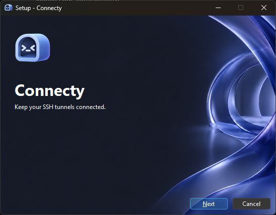

<p align="center">
  
</p>

<h1 align="center"> Connecty</h1>

A small, native Windows tunnel manager. The Rust agent keeps SSH connections
alive; the C++20 / WinUI 3 window opens only when you need it.

Developed and published by [Chromatic](https://chromatic.hu).

Licensed under **AGPL-3.0-or-later**. Third-party components retain their own licenses.

## Install

Download **Connecty-Setup-x64.exe** or **Connecty-Setup-arm64.exe** from [Releases](https://github.com/Has-X/Connecty/releases/latest).
Windows 11 x64 or ARM64 is required. Choose the installer matching your device. Setup installs for your user without administrator
rights and downloads Microsoft's shared Windows App SDK 2 runtime only if needed.
A portable ZIP is available too; it requires that runtime to be installed already.
No browser, .NET runtime or OpenSSH client is bundled.



## Use

1. Add an SSH server or an alias from your SSH config.
2. Choose reverse or local forwarding and set the listening and destination ports.
3. Connect. Turn on **Run at sign-in** in Settings for unattended operation.

Closing the window exits the UI and keeps your tunnels running in the agent.
Use the tray for quick controls. Reopening it loads WinUI on demand; the main
screen is built only when opened.
Each profile's **Connect on start** switch selects the tunnels started by the agent.
The optional return-path check reports whether your own verification command
succeeded; it is separate from SSH connectivity.

Listeners are loopback-only (`127.0.0.1`, or `::1` in profile JSON). Connect to a
reverse listener from its SSH server or through a separate authenticated route.
An SSH service on the destination PC is separate software; Connecty is an SSH
**client**, never an SSH server. Other TCP services can be forwarded too.

## Trust and keys

Connecty checks the server against your existing `~/.ssh/known_hosts` (or the
profile's selected file), including hashed entries. Unknown, changed, revoked,
or unsupported certificate keys stop the connection without automatic retries.
It never silently accepts a key and has no "ignore host key" switch. Verify a
new key's SHA-256 fingerprint through a trusted channel before adding it to
known_hosts. The reported fingerprint alone does not prove the server's identity.

Ed25519 and ECDSA OpenSSH-format private keys are loaded directly by
russh. Encrypted keys can be unlocked in the UI. Passphrases are not saved;
an unlocked key remains in agent memory for reconnects until disconnection.
Encrypted keys need unlocking again after an agent restart. Password login,
external identity agents, hardware tokens and host certificates are unsupported.
RSA is disabled because its optional implementation has an unresolved
[timing-side-channel advisory](https://rustsec.org/advisories/RUSTSEC-2023-0071).

The SSH config importer supports `Host` patterns and exclusions, `HostName`,
`User`, `Port`, the first `IdentityFile`, `UserKnownHostsFile` and `HostKeyAlias`,
with first-value-wins behavior. It is not a complete OpenSSH config interpreter.
`Include`/`Match` rules require explicit hostname, username and identity fields.
`ProxyJump`/`ProxyCommand` are unsupported. Unsupported routing rules fail closed;
they are never executed as subprocesses.

## Reliability and footprint

- One current-thread Tokio runtime; independent connection tasks and cancellation.
- Embedded russh transport, bounded queues and 64 streams per connection.
- SSH keepalives every 20 seconds; three missed replies expire a stale session.
- Exponential reconnect delays with jitter, capped at 75 seconds. Permanent
  authentication, configuration and trust failures require user action.
- Native Windows address-change and power notifications trigger recovery;
  suspend releases sockets, resume rebuilds sessions. No lifecycle polling loop.
- The agent owns the tray icon. The WinUI process can exit completely.
- A small launcher in the same Rust binary waits on the agent's process handle
  and restarts abnormal exits with backoff. Normal shutdown also exits the launcher.
- Up to 32 profiles, 32 structured activity entries per profile. No disk log stream,
  telemetry, updater, remote control server, or continuously running UI timer.

A dead server-side SSH session can temporarily retain a reverse port after an
outage. Connecty never kills another session. The server should expire dead
clients with an appropriate sshd keepalive policy. An unrelated tunnel manager
using the same port must be stopped separately; existing scheduled tunnels are
not automatically imported or disabled.

## Data and startup

Profiles remain at `%LOCALAPPDATA%\Connecty\profiles.json`. Existing profiles
are read with compatible defaults, backed up once to `profiles.pre-agent.json`,
and replaced atomically on edits. Invalid saved data is reported and never
silently overwritten. Recent activity is bounded in memory. Connection history
is saved locally by default in `Logs` beneath the profile directory, with two
rotating files of up to 2 MiB each and a seven-day age limit. Settings can disable
recording, change the folder, or adjust retention and file size. Cleanup runs
when logs are written or browsed, with no idle polling. Changing folders leaves
old files intact. The in-app History view searches the latest 256 retained records.
Records include profile, timestamp, SSH account, peer address, stream lifetime
and byte counts; no forwarded content, passwords or private keys are recorded.
Peer addresses come from the SSH server for reverse streams. End-user sign-ins
are recorded by the destination service, not inferred by Connecty. A bounded
startup error file and UI error file aid diagnosis. Do not publish machine-specific
data or keys.

Startup uses a per-user Task Scheduler logon task at limited privilege, without
password storage or elevation. It has no execution-time cap, permits battery
operation, and launches the crash-recovery wrapper. It runs while that user is logged in;
it stops at logout. Disable startup before moving or deleting the extracted folder;
re-enable it from the new location.
The task records the resolved physical data folder, so launches from packaged
hosts and normal Windows login share the same profiles. Disabling login leaves
a disabled task as that folder locator; it does not run in the background.

IPC uses a local, SID-scoped Windows named pipe with an explicit user/SYSTEM
DACL, remote-client rejection, client SID validation and server SID/executable
validation. Requests are versioned, length-framed and bounded. See
[architecture](docs/architecture.md) for the protocol and lifecycle.

## Build and verify

Install Rust (MSVC target), Visual Studio 2022 desktop C++ tools, CMake/Ninja,
and a Windows 11 SDK with C++/WinRT. From PowerShell:

```powershell
./scripts/build.ps1 -Test -Package -Architecture x64
# On an ARM64 Windows machine:
./scripts/build.ps1 -Test -Package -Architecture arm64
cargo clippy --manifest-path agent/Cargo.toml --locked --all-targets -- -D warnings
```

The script restores pinned Microsoft build metadata, generates WinRT headers,
builds both native binaries with a static CRT, runs unit checks and creates
`dist/Connecty-x64.zip` or `dist/Connecty-arm64.zip`. Only the small Windows App SDK bootstrap DLL is included;
the shared WinUI runtime is installed separately. WebView2 metadata is a WinUI
build reference only; no browser component is shipped or used.

[Testing](docs/testing.md) describes the opt-in real-server fault suite and
physical sleep/resume checks. CI unit tests alone do not prove live forwarding,
Windows sleep behavior, login startup, or long-term reliability.
See the [local validation record](docs/validation.md) for completed checks and limits.

## Release

AGPL-3.0-or-later; see [LICENSE](LICENSE) and [NOTICE](NOTICE). Owner-supplied Fluent artwork: `controlly-logo.png`, optimized to
512px with transparency. `scripts/make-icon.ps1` derives Windows icon
sizes and tray states. Review the ZIP and third-party licenses before publication.
Releases are currently unsigned. Installer and WinGet details are in
[installation](docs/installation.md).
